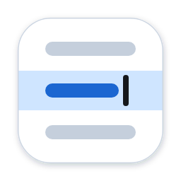
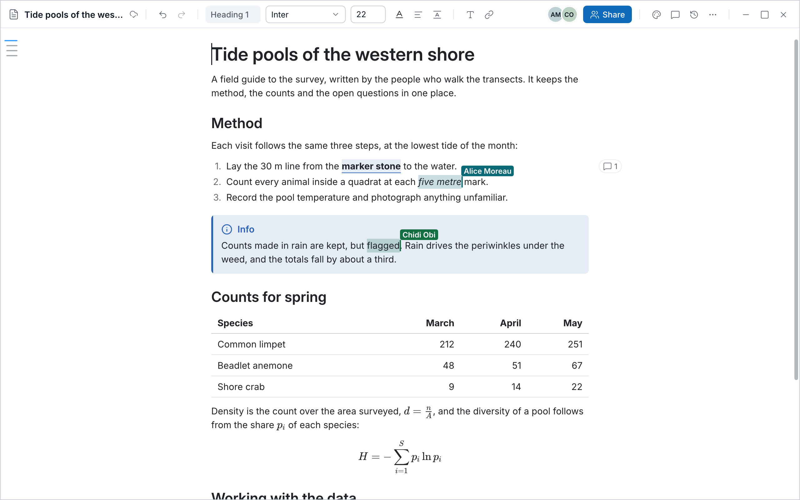
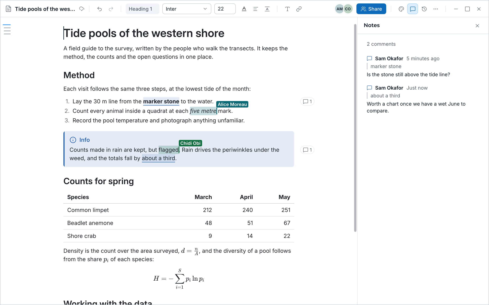
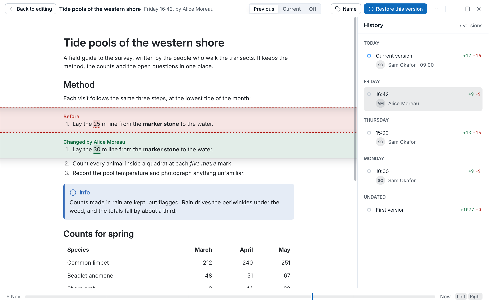
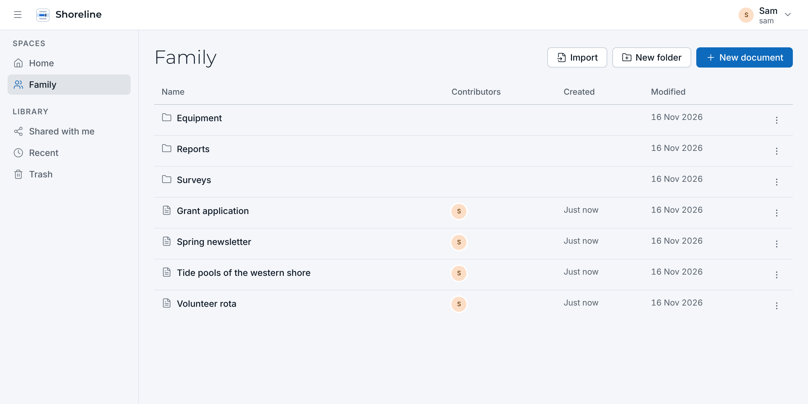

<p align="center"></p>

<h1 align="center">Letters</h1>

<p align="center">
  A local-first document editor for the desktop and the browser.<br />
  One Rust engine, one self-contained <code>.let</code> file per document, and a server you host yourself.
</p>

<p align="center">
  <a href="https://github.com/SierraSoftworks/letters/releases/latest"></a>
  <a href="https://github.com/SierraSoftworks/letters/actions/workflows/ci.yml"></a>
</p>

<p align="center">
  <picture>
    <source media="(prefers-color-scheme: dark)" srcset="assets/screenshots/editor-dark.png" />
    
  </picture>
</p>

Letters is a replacement for Word and Google Docs that keeps your documents yours. Every document is a file
on your disk that holds its text, pictures, comments and whole history. The server adds identity, sharing and
live collaboration without owning any content: take it away and every file still opens.

## Features

### Writing

- **Rich documents.** Headings, lists, tables, figures and galleries, callouts, quotes, a table of contents,
  link previews and cross-references to figures.
- **Maths and code.** Formulas typed as TeX and typeset in place, and code blocks highlighted by language
  with a copy button.
- **Markdown as you type.** `#`, `-`, `>`, `**bold**` and the rest become formatting, alongside a command
  palette, find and replace, and spell checking with Hunspell dictionaries.
- **Styles.** A document's fonts, sizes, colours and spacing are edited in one place, in light or dark, with
  an accent of your choosing.
- **Every script.** Right-to-left text, CJK and South-East Asian line breaking, and colour emoji, with the
  same open-licence fonts on every system.

### Reviewing

- **Comments.** Notes anchored to a passage, with replies, shown in the margin and in a panel.
- **History.** Every version of a document, who wrote it and what it changed, to read, name, copy from or
  restore.
- **Conflicts.** Copies that diverged on two devices merge back into one document, with each difference
  reviewed side by side.

<p align="center">
  <picture>
    <source media="(prefers-color-scheme: dark)" srcset="assets/screenshots/comments-dark.png" />
    
  </picture>
</p>

<p align="center">
  <picture>
    <source media="(prefers-color-scheme: dark)" srcset="assets/screenshots/history-dark.png" />
    
  </picture>
</p>

### Files

- **One file per document.** A `.let` file is a zip of JSON, pictures and history that syncs through any
  folder service and survives a crash through its journal.
- **Import.** Markdown and Word documents, one at a time or by the folder.
- **Export.** PDF, Word, Markdown and a single-file web page, from the app, the server or the command line.
- **Safe by default.** A document from elsewhere opens in safe mode: nothing remote is fetched until you
  trust its sources.

### Sharing

- **A server you host.** `letters-server` shares folders of documents with the people your identity provider
  names. It is one static binary or a container image.
- **Live collaboration.** People edit the same document together from the desktop app or the browser, and
  see each other's carets and selections.
- **Links and roles.** Owners, editors, commenters and readers, plus links that can be limited to reading
  and kept from copying, printing or downloading, with a log of who opened what.

<p align="center">
  <picture>
    <source media="(prefers-color-scheme: dark)" srcset="assets/screenshots/server-dark.png" />
    
  </picture>
</p>

### Everywhere

- **Desktop.** Native on macOS, Linux and Windows, drawn on the GPU with a CPU fallback, and quick to launch.
- **Browser.** The same engine compiled to WebAssembly and painted on a canvas, served by your server.
- **Command line.** `letters export` and `letters import` convert documents without opening a window.

## Installing

Each [release](https://github.com/SierraSoftworks/letters/releases/latest) carries the desktop app for every
system. Letters is not signed with a paid developer certificate, so macOS and Windows ask before they open it
the first time.

- **macOS.** Open `Letters.dmg` and drag Letters to Applications. Then either:
  - open Letters, press Done when macOS says it could not verify it, and press Open Anyway under
    System Settings > Privacy & Security; or
  - run `xattr -dr com.apple.quarantine /Applications/Letters.app` in Terminal, which also helps when macOS
    calls the app damaged.
- **Windows.** Run `letters-x86_64-pc-windows-msvc.exe` from a folder of your own, where it can replace
  itself with newer releases. When SmartScreen stops it, press More info, then Run anyway.
- **Linux.** `chmod +x letters-x86_64-unknown-linux-gnu`, put it on your `PATH` as `letters`, and run
  `./scripts/install-desktop.sh` from this repository for the desktop entry and icons.

Letters looks for a newer release when it starts and offers to restart into it. The Mac app is pointed at the
release's page instead, and is allowed the same way after each download. Turn the look off with
`[updates] check = false` in `~/.letters/settings.toml`, or with `LETTERS_UPDATES=0` in the environment.

## Hosting a server

`letters-server` is published with each release as a static Linux binary and as the image
`ghcr.io/sierrasoftworks/letters-server`. It needs an OpenID Connect provider and folders to share.

- [Letters on a tailnet](apps/letters-server/docs/tailscale.md) sets one up with Tailscale as the provider.
- [Operating a server](apps/letters-server/docs/operating.md) covers its settings, log, health and upkeep.

## Command line

```sh
letters notes.let                        # open a document
letters export --to pdf notes.let        # md, html, docx, pdf, or clean for a copy with no history
letters import --recursive ~/Documents   # bring in Markdown and Word files
```

## Usage reports

Release builds of the desktop app tell `analytics.sierrasoftworks.com` which features are used and how long
sessions last, as the site `letters.app` with its pages under `/desktop`: page and event names out of a closed list in `apps/letters/src/telemetry.rs`, the version, the
system's kind, its language and time zone, and a random number that lasts one run. Nothing of a document or
of a person is sent, and no errors. Turn it off in Settings, with `[telemetry] enabled = false` in
`~/.letters/settings.toml`, or with `LETTERS_TELEMETRY=0` or `DO_NOT_TRACK=1` in the environment.

## Working on it

```sh
./scripts/check.sh   # format, lint, test and the wasm build
./scripts/budgets.sh # the launch and keystroke budgets, on a release build
./scripts/fuzz       # names the fuzz targets, and runs one under AFL++ when given its name
```

The browser shell is built and tested from `apps/letters-web`:

```sh
./build.sh           # the page into dist/, and a report of the wasm's size
npm start            # serve it at http://localhost:8080/
npm install && npx playwright install firefox chromium && npm test
```

## Layout

- `crates/letters-model`: the document, its operations and selections.
- `crates/letters-format`: the `.let` container.
- `crates/letters-render`: the display list and its backends.
- `crates/letters-fonts`: the bundled open-licence fonts.
- `crates/letters-layout`: paragraph and page layout.
- `crates/letters-editor`: commands, Markdown input rules, keymap, clipboard and composition.
- `crates/letters-ui`: the native widgets and the editor window's panels.
- `crates/letters-convert`: import and export.
- `crates/letters-spell`: spell checking with Hunspell dictionaries, English bundled.
- `crates/letters-trust`: safe mode, trusted sources and the guards on remote image fetches.
- `crates/letters-api`: what a server and the shells say to each other over HTTP.
- `crates/letters-test`: the headless interaction-test harness.
- `apps/letters`: the desktop app.
- `apps/letters-web`: the browser shell, which paints the same engine on a canvas.
- `apps/letters-server`: the server, which shares folders of documents with the people an identity provider names.
  [Letters on a tailnet](apps/letters-server/docs/tailscale.md) sets one up with Tailscale as that provider.
- `fuzz`: the fuzz targets, which a nightly workflow runs and files issues from.
